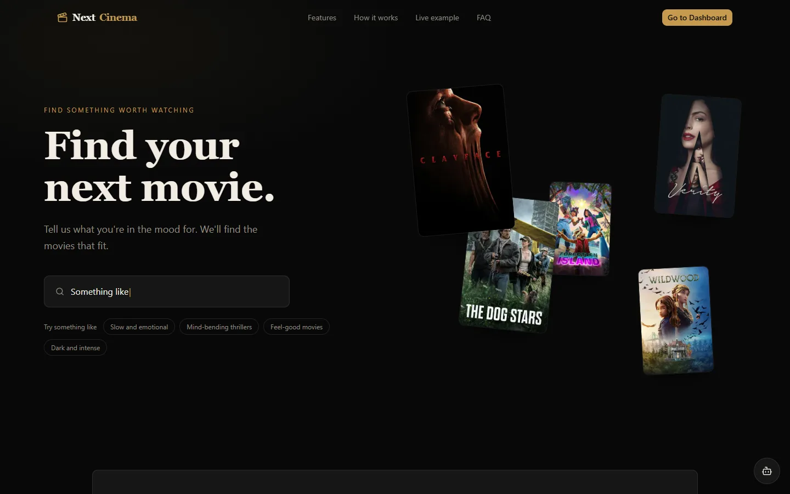
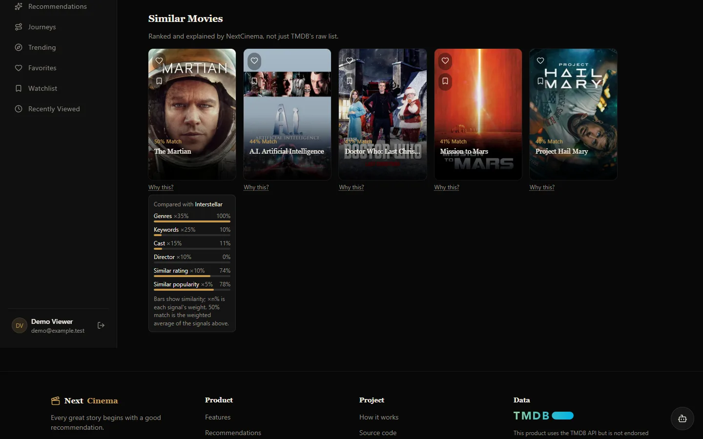
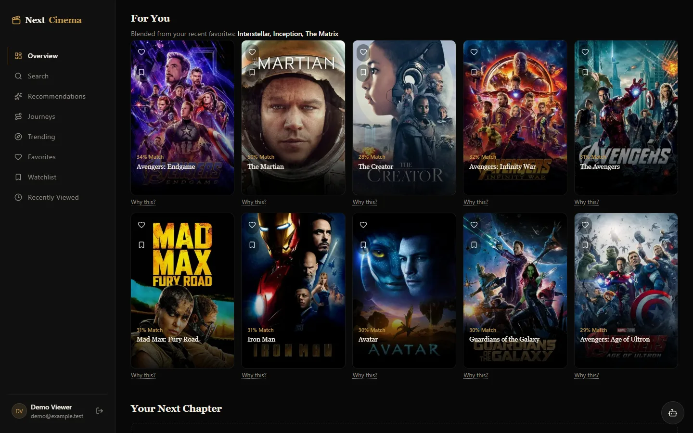
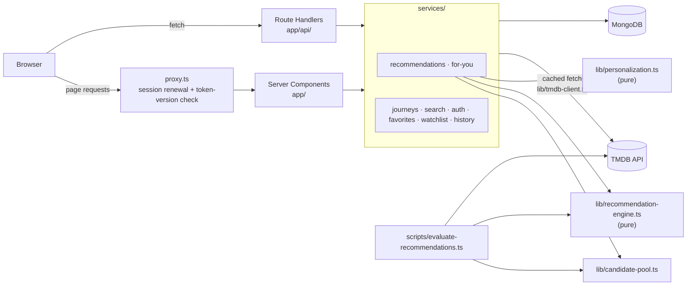

# NextCinema

[](https://github.com/manideep311/NextCinema/actions/workflows/ci.yml)
[](LICENSE)

Movie discovery with **explainable, content-based recommendations**. Every
match comes with a score you can take apart: which signals matched, how
strongly, and how much each one weighs.

**Live:** https://nextcinema-311.vercel.app



| A movie page with **Why this?** open | For You, blended from three favourites |
|---|---|
|  |  |

<sub>Captured on 2026-10-29 from a local production build, with live TMDB data
and a throwaway demo account whose favourites are The Matrix, Inception and
Interstellar. Scores drift as TMDB votes and popularity change.</sub>

## What it does

- **Recommendations that explain themselves.** Similar movies and For You
  picks show a match % and a **Why this?** panel that breaks the score down
  per signal.
- **For You** blends your five most recent favourites, weighted toward the
  newest ones.
- **Movie Journeys** cover franchise watch orders (release, chronological,
  essentials) plus genre, theme and mood journeys, with progress tracking.
- **Search** that understands moods, decades, languages, "like X", actors and
  directors. It uses rule-based interpretation, not an LLM.
- Favourites, watchlist, recently viewed, "mark as watched", and where to
  watch (TMDB × JustWatch).

## How recommendations work

The engine ([`lib/recommendation-engine.ts`](lib/recommendation-engine.ts))
is content-based, pure and deterministic. There is no trained model and no
user-behaviour data. It compares a candidate with the seed movie on six
signals:

| Signal | Weight | Similarity |
|---|---|---|
| Genres | 35% | Jaccard overlap of TMDB genre ids |
| Keywords | 25% | Jaccard overlap of TMDB keywords |
| Cast | 15% | Jaccard overlap of the top 5 billed cast, by TMDB person id |
| Director | 10% | Jaccard overlap of all credited directors, by TMDB person id |
| Rating | 10% | Closeness of Bayesian-adjusted ratings (prior mean 6.5, 100 prior votes): 1 − gap / 3 |
| Popularity | 5% | Closeness of log₁₀(1 + popularity): 1 − gap / 2 |

**Match % = Σ similarity × weight ÷ Σ weight, over the signals that apply.**
A signal the seed has no data for is skipped. Keywords and cast are also
skipped when the *candidate* has none on TMDB, because missing data isn't
evidence of difference. Rating and popularity measure closeness to the seed
rather than "higher is better", so a cult favourite leads to cult favourites
instead of blockbusters.

**Candidates** come from TMDB `/similar` (pages 1–2), `/recommendations`, and
the most-voted `/discover` titles in the seed's first two genres. They are
merged round-robin, de-duplicated and capped at 40
([`lib/candidate-pool.ts`](lib/candidate-pool.ts)). Thinly voted films are
kept; the Bayesian rating stops a handful of votes from counting as a strong
rating.

**For You** ([`lib/personalization.ts`](lib/personalization.ts)) takes each of
your five most recent favourites, newest first, with weights 1, 0.8, 0.6, 0.4
and 0.2. It ranks candidates by Σ weight × match across those lists, then
drops anything you've favourited or watched. Each pick is explained against
the favourite that contributes most to it.

### Worked example: Interstellar → The Martian (51%)

These are real TMDB values fetched on 2026-10-18. Votes and popularity drift,
so the live numbers will differ slightly.

| Signal | Interstellar | The Martian | Similarity | Weight | Contribution |
|---|---|---|---|---|---|
| Genres | Adventure, Drama, Science Fiction | the same three | 3 / 3 = 1.00 | 0.35 | 0.350 |
| Keywords | 29 keywords | 17 keywords | 4 shared / 42 = 0.10 | 0.25 | 0.024 |
| Cast (top 5) | McConaughey, Hathaway, Caine, Chastain, Affleck | includes Jessica Chastain | 1 shared / 9 = 0.11 | 0.15 | 0.017 |
| Director | Christopher Nolan | Ridley Scott | 0.00 | 0.10 | 0.000 |
| Rating | 8.49 from 41,516 votes → 8.49 adjusted | 7.71 from 21,968 votes → 7.71 adjusted | 1 − 0.78 / 3 = 0.74 | 0.10 | 0.074 |
| Popularity | 74.4 → log 1.88 | 40.7 → log 1.62 | 1 − 0.26 / 2 = 0.87 | 0.05 | 0.044 |
| **Total** | | | | **1.00** | **0.508 → 51%** |

All six signals apply here, so the denominator is 1.00. The card's reasons
come from the same overlap: *Shares genres: Adventure, Drama, Science Fiction
· Features Jessica Chastain · Similar themes: spacecraft, nasa, space*.

## Evaluation

[`docs/evaluation.md`](docs/evaluation.md) has the full method, per-seed
results and limitations. To reproduce:

```bash
npm run eval
```

The evaluation uses 50 of TMDB's most-voted movies as seeds and TMDB's
`/recommendations` as weak ground truth. That source is removed from the
candidate pool to avoid leakage. On 2026-10-18:

| Method (same candidate pool) | precision@10 | nDCG@10 |
|---|---|---|
| TMDB `/similar` order | 0.010 | 0.017 |
| Genre-only Jaccard | 0.274 | 0.288 |
| NextCinema engine | 0.318 | 0.368 |

Only 3.7 of the ~20 ground-truth movies per seed were in the pool at all, so
no re-ranking could exceed 0.374 precision@10. This compares methods against
another recommender, not against what people actually liked. See the
limitations in the doc before reading much into it.

## Architecture



- **Pure core.** Scoring, candidate pooling, For You blending, journey
  ranking, search interpretation and the evaluation metrics are pure
  functions in `lib/`, unit-tested without network or database.
- **Public vs user data.** TMDB data and per-movie recommendation lists are
  cached in Next's Data Cache and shared across users. User data (favourites,
  watchlist, history, watched) never goes into a shared cache.
- **TMDB client** ([`lib/tmdb-client.ts`](lib/tmdb-client.ts)) handles
  in-flight de-duplication, a concurrency cap, timeouts, and retries on 429
  and any 5xx.

## Stack

Next.js 16 (App Router) · React 19 · TypeScript · Tailwind CSS v4 · Framer
Motion · MongoDB (official driver) · `jose` JWT sessions · scrypt passwords
(`node:crypto`) · TMDB API.

## Setup

1. **Install dependencies**

   ```bash
   npm install
   ```

2. **Configure environment variables**

   ```bash
   cp .env.local.example .env.local
   ```

   | Variable | Required for | Notes |
   |---|---|---|
   | `TMDB_API_READ_ACCESS_TOKEN` | all movie data | [Get one free from TMDB](https://www.themoviedb.org/settings/api) |
   | `MONGODB_URI` | accounts, favourites, watchlist, history | [MongoDB Atlas](https://www.mongodb.com/cloud/atlas/register) has a free tier, or run MongoDB locally |
   | `MONGODB_DB` | — (optional) | Database name, default `nextcinema`. Deployments created before the rename used `cinematch`; set `MONGODB_DB=cinematch` there to keep existing data |
   | `AUTH_SECRET` | sign in / sign up | At least 32 random characters: `openssl rand -base64 32` |
   | `NEXT_PUBLIC_TMDB_IMAGE_BASE_URL` | — (optional) | Image CDN base, default `https://image.tmdb.org/t/p`. Another host must also be added to `images.remotePatterns` in `next.config.ts` |
   | `WATCH_REGION` | — (optional) | Default country for Where to Watch (ISO 3166-1), default `IN` |

   Without `MONGODB_URI` / `AUTH_SECRET` the app still runs as a guest:
   browsing, search, trending and categories work, and account features are
   unavailable.

3. **Create the database indexes** (idempotent, safe to re-run)

   ```bash
   npm run db:indexes
   ```

4. **Run it**

   ```bash
   npm run dev
   ```

   Then open http://localhost:3000.

## Tests

```bash
npm test
```

Uses Node's built-in test runner via `tsx`. Coverage includes:

- the recommendation engine (a reference re-implementation of the formula,
  re-weighting, id-based people matching, closeness signals);
- candidate pooling, For You blending and the evaluation metrics;
- journeys, search interpretation, auth tokens, validation and rate-limit IP
  selection;
- route handlers for signup, login, logout and favourites, run against an
  in-memory MongoDB (`mongodb-memory-server`, no setup needed);
- a render test of the **Why this?** panel.

[CI](.github/workflows/ci.yml) runs typecheck, lint and tests on every push
and pull request.

| Command | Description |
|---|---|
| `npm run dev` / `build` / `start` | Next.js dev server, production build, production server |
| `npm run lint` | ESLint |
| `npm test` | Unit, route and DB tests |
| `npm run eval` | Offline recommendation evaluation (needs a TMDB token); updates `docs/evaluation.md` |
| `npm run db:indexes` | Create or update MongoDB indexes |
| `npm run verify:live` | End-to-end checks against a running server (`BASE_URL`). It creates throwaway accounts, so point the server at a test database |

## Security notes

- **Sessions.** An HS256 JWT in an `httpOnly`, `SameSite=Lax`,
  `Secure`-in-production cookie; issuer, audience, expiry and payload shape
  are validated. Tokens last 7 days and are renewed after a day of use. Each
  token carries the user's `tokenVersion`. Signing out increments it, which
  revokes every earlier token: authenticated API routes and server-rendered
  pages (`getSession`) check the version on every request, and `proxy.ts`
  refuses to renew a token whose version is behind. If the version lookup
  fails, API routes that touch user data fail closed (503) while page
  rendering keeps the session.
- **Authorization.** User ids come only from the verified session. Strict
  body schemas reject client-sent `userId`, `role` and similar fields, and
  movie snapshots are resolved from TMDB server-side.
- **Passwords.** scrypt (N=2¹⁵, r=8, p=1). At login, unknown emails pay the
  same hashing cost as wrong passwords and get the same error. At signup, the
  password is hashed before the duplicate check, so a taken email takes as
  long as a new account, and a taken email and invalid input get the same 400
  with the same message.
- **Rate limits.** In-memory fixed windows keyed by user or client IP. The IP
  comes from proxy-set headers (`x-vercel-forwarded-for`, `x-real-ip`, then
  the last `X-Forwarded-For` hop), never the client-supplied first hop. See
  `getClientIp` in [`lib/http.ts`](lib/http.ts) for the trust assumption.

## Limitations

- **Content-based only.** Recommendations depend on TMDB metadata: films
  with sparse keywords or credits are matched mostly on genre. Nothing learns
  from what users actually watch or like.
- **Evaluation against a proxy.** The only measurement so far is agreement
  with TMDB's own recommender on 50 popular seeds (see
  [`docs/evaluation.md`](docs/evaluation.md)). It hasn't been checked against
  real user judgements.
- **No password change, reset or email verification.** Without
  verification, a successful signup still reveals that an email was free.
- **Rate limits are per server instance** (in-memory), so they're
  best-effort across instances.
- **Cold starts.** The first request after a deploy builds the journey
  catalog (about 5 s measured locally); later requests are served from
  cache.

## Credits

Movie data and images from [TMDB](https://www.themoviedb.org/). This product
uses the TMDB API but is not endorsed or certified by TMDB. Streaming
availability from JustWatch via TMDB.

## License

[MIT](LICENSE) © 2026 Manideep Chittimodu
